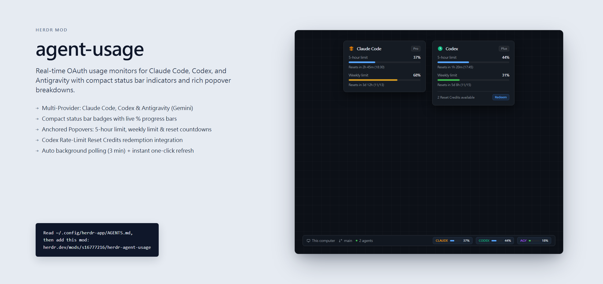

# Herdr Agent Usage

A real-time AI coding agent OAuth usage monitor and status bar mod for the **[Herdr app](https://github.com/herdr/herdr-app)**.



Track live token quotas, 5-hour rate limits, weekly caps, and precise reset countdowns for **Claude Code**, **Codex**, and **Antigravity (Gemini)** directly from your Herdr status bar.

## 🌟 Features

- **⚡ Multi-Provider Support**:
  - **Claude Code**: Live 5-hour limit, 7-day quota, and reset clock.
  - **Codex**: 5-hour limit, weekly limit, plus **Rate-Limit Reset Credits** redemption.
  - **Antigravity**: Pro/Flash 5-hour quota, Argon Weekly, and Claude/GPT credits breakdown.
- **📊 Compact Status Bar Indicators**: Mini 36px color-coded progress bars (`[Icon] [Bar] X%`) that sit cleanly in your bottom status bar without clutter.
- **🪟 Anchored Detail Popovers**: Click any provider badge to pop out a rich breakdown card showing exact percentages, reset dates, and countdown timers.
- **🔄 Auto & Manual Refresh**: Automatically polls in the background every 3 minutes, with an instant one-click refresh button in the popover header.
- **🔒 Secure Local Credential Resolution**: Safely reads local CLI session tokens (`~/.claude`, `~/.codex`, and DPAPI-encrypted Google Cloud Code) without prompting for passwords.

---

## 🚀 Installation (Herdr Standard)

This mod strictly follows the **[Herdr App Mod Sharing Specification](https://github.com/herdr/herdr-app#layouts-and-mods-other-people-made)**.

### Method 1: Ask Your Agent (Official & Recommended)
Tell any AI coding agent working in Herdr:

> *"Add mod `s16777216/herdr-agent-usage`"*
>
> or
>
> *"Install mod from `https://github.com/s16777216/herdr-agent-usage`"*

Your agent will follow Herdr's official protocol:
1. Read `RECIPE.md` to inspect safety, permissions, and dependencies.
2. Copy `mods/agent-usage/` into your `~/.config/herdr-app/mods/agent-usage/`.
3. Verify the installation with `herdr-app check ~/.config/herdr-app/mods/agent-usage`.
4. Update your active layout JSON's status slot to use `"mod": "agent-usage"`.

---

### Method 2: Manual Installation

#### 1. Copy the Mod Folder
Clone or download this repository, then copy `mods/agent-usage` to your Herdr configuration directory:

- **Windows**: Copy to `%USERPROFILE%\.config\herdr-app\mods\agent-usage`
- **macOS / Linux**: Copy to `~/.config/herdr-app/mods/agent-usage`

#### 2. Configure Your Layout
In your custom layout file (e.g. `~/.config/herdr-app/layouts/my-layout.json`), set the status block content:

```json
{
  "id": "status",
  "type": "block",
  "content": {
    "mod": "agent-usage"
  },
  "size": {
    "px": 28
  }
}
```

#### 3. Verify
Run the official Herdr verification command:
```bash
herdr-app check ~/.config/herdr-app/mods/agent-usage
```

---

## 🛠️ Repository Structure

Mirrors the Herdr home directory layout:

```
herdr-agent-usage/
├── RECIPE.md            # Herdr specification recipe
├── preview.png          # Visual preview banner (2200x1040)
├── keys.json            # Default keyboard shortcuts
├── README.md            # Documentation
└── mods/
    └── agent-usage/     # Status bar and popover mod
        ├── main.js
        ├── mod.json
        ├── refresh.svg
        └── read-agy-cred.ps1
```

---

## 📄 License
MIT License. Feel free to use, customize, and share!
