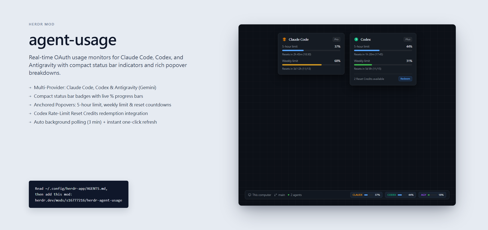

# Agent Usage

A high-density, real-time AI coding agent OAuth usage monitor and status bar mod for the Herdr app. It tracks live token utilization, 5-hour rate limits, weekly quotas, and precise reset countdowns for **Claude Code**, **Codex**, and **Antigravity (Gemini)** with compact status bar indicators, anchored details popovers, and Codex rate-limit reset credit redemption.

## What you see

The mod replaces or enhances the workspace status bar (`slot: "status"`, height 28px, background `theme().chrome`, top border `theme().border`). From left to right:

1. **Workspace Context (Left)**:
   - Machine indicator: 13px server/monitor icon and machine label (`theme().muted`).
   - Git branch: 13px branch icon and active branch name in `theme().dim`.
   - Active agents counter: colored status dot (dim or blocked red) and running agent count.
2. **Flexible Spacer (Center)**: Expands dynamically to keep usage badges right-aligned.
3. **Agent Usage Badges (Right)**:
   - Compact capsule pills (height 20px, px 6, gap 6, rounded 5):
     - Provider icon: 14px SVG/PNG (`Claude`, `Codex`, `Antigravity`).
     - Mini progress bar: 36px wide, 4px high track with rounded-full ends, filled dynamically according to utilization percentage.
     - Percentage text: 11px font semibold (`theme().foreground` when high, `theme().muted` normal).
   - Color coding:
     - Normal (< 70%): `theme().accent` or provider brand tone.
     - Warning (70% - 89%): `theme().ansi3` (amber/yellow).
     - Critical (>= 90%): `theme().ansi1` (red).
4. **Usage Details Popover (Anchored Popup)**:
   - Opened upon clicking any badge (width 296px, rounded 10, background `theme().popover`, border 1 `theme().border`, floating above the clicked badge).
   - **Header**: Provider icon, name, plan tier badge (e.g. `Pro`, `Plus`), and a 14px rotating refresh button.
   - **Limit Progress Rows**:
     - 5-hour limit: utilization progress bar (268px wide, 6px high), percentage, and precise reset clock/countdown.
     - Weekly limit: utilization progress bar, percentage, and reset date/countdown.
     - Antigravity specific: separate breakdowns for Gemini Pro/Flash, Argon Weekly, and Claude/GPT credits.
     - Codex specific: rate-limit reset credits redemption button and confirmation dialog.
   - **Footer**: Last updated relative timestamp.

## How it behaves

- **Automatic Background Polling**: Polls OAuth usage endpoints every 180 seconds (3 minutes) in the background and caches results in shared memory.
- **Provider Authentication**:
  - **Claude Code**: Reads `~/.claude/.credentials.json`, extracts `claudeAiOauth` access token, and queries `https://api.anthropic.com/api/oauth/usage`.
  - **Codex**: Reads `~/.codex/auth.json`, extracts access token & account ID, and queries `https://chatgpt.com/backend-api/wham/usage`.
  - **Antigravity**: Executes `read-agy-cred.ps1` via DPAPI to decrypt local Google Cloud Code refresh tokens, refreshes access token, and queries Cloud Code internally.
- **Popover Toggling**: Clicking any provider badge opens its anchored popup. Pressing `Escape` or clicking elsewhere dismisses it.
- **One-Click Manual Refresh**: Clicking the refresh icon in the popover header instantly re-fetches credentials and updates progress bars.

## Built from

- **GPUI Elements**: `v_flex`, `h_flex`, `div`, `svg`, `image`.
- **Herdr APIs**: `spaces`, `agents`, `theme`, `run`, `home`, `appHome`, `exec`, `readTextFile`, `openOverlay`, `closeOverlay`, `props`, `shared`, `setShared`.
- **Companion Helper**: `read-agy-cred.ps1` (Windows DPAPI credential helper for Antigravity).
- **Art**: `refresh.svg`, provider icons in `icons/`.

## Watch out

- **Token Expiry & Rate Limits**: Usage endpoints may return HTTP 401 on expired tokens; the mod caches tokens gracefully and shows human-readable error messages without crashing the status bar.
- **Windows Credential Encryption**: Antigravity credentials on Windows are encrypted with DPAPI; the helper script safely invokes PowerShell to retrieve tokens without exposing secrets to shell history.
- **Status Bar Slot**: The mod takes the `"status"` slot in layout JSON. Set `"size": { "px": 28 }` in your layout file.

## Done when

1. `herdr-app check mods/agent-usage` exits with code 0.
2. Status bar renders the active machine, git branch, agent count, and active provider usage badges.
3. Hovering over a badge shows its tooltip and clicking it smoothly pops out the detailed breakdown card.
4. Clicking the popover refresh button triggers a smooth spinner and reloads quotas.
5. Pressing `Esc` cleanly closes the popover.
